<div align="center">
  <picture>
    <source media="(prefers-color-scheme: dark)" srcset="assets/terminal-dark.v2.svg">
    <source media="(prefers-color-scheme: light)" srcset="assets/terminal-light.v2.svg">
    
  </picture>
</div>

---

## `$ ls ~/stack`

`├─ lenguajes/`


`├─ datos_y_ml/`


`├─ bases_de_datos/`


`├─ web/`


`╰─ herramientas/`


---

## `$ ls ~/proyectos`

[Recomendador de juegos de Steam](https://huggingface.co/spaces/jojimene/steamGamesRecomendator) · desplegado en Hugging Face Spaces

[Spoty Stats Data Science Proyect ](https://github.com/pagaliv/spotify-data-science)


---

## `$ ./modding --info`

```text
[game] Super Smash Bros. Ultimate
[info] Modding de audio: conversión al formato del juego
       y búsqueda de puntos de loop (loop finders)
[tool] Audacity · Sm5shMusic · SARC-Tool · Blender · GIMP
```

---

## `$ mail --to jorge`

[](https://linkedin.com/in/jorgejimenezsdt)
[](mailto:jorge.jimenez.sdt@gmail.com)
